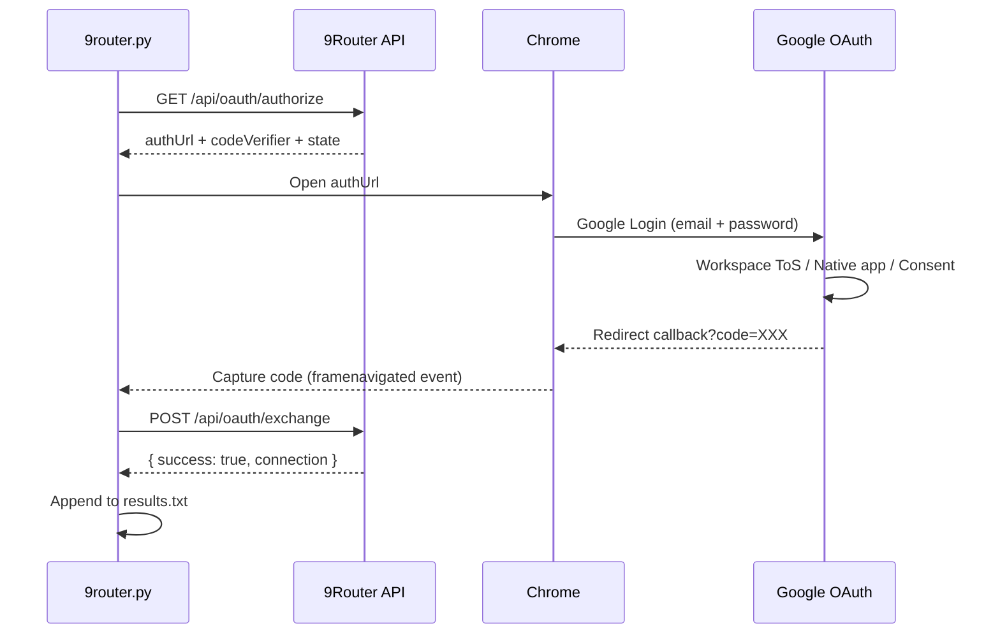

<div align="center">

<pre>
<<<<<<< HEAD
```
=======
>>>>>>> a22910e65ba7bea029403284eb3de61f96c0153d
█████╗ ██████╗  ██████╗ ██╗   ██╗████████╗███████╗██████╗
██╔══██╗██╔══██╗██╔═══██╗██║   ██║╚══██╔══╝██╔════╝██╔══██╗
╚██████║██████╔╝██║   ██║██║   ██║   ██║   █████╗  ██████╔╝
 ╚═══██║██╔══██╗██║   ██║██║   ██║   ██║   ██╔══╝  ██╔══██╗
 █████╔╝██║  ██║╚██████╔╝╚██████╔╝   ██║   ███████╗██║  ██║
 ╚════╝ ╚═╝  ╚═╝ ╚═════╝  ╚═════╝    ╚═╝   ╚══════╝╚═╝  ╚═╝
<<<<<<< HEAD
```
</pre>
>>>>>>>>> Temporary merge branch 2
</div>

**Mass Google OAuth Automation for 9Router**

[](https://python.org)
[](https://playwright.dev)
[](LICENSE)

*Single-file · zero-config · multi-worker · rainbow CLI*
<br>
*Connect hundreds of Google Workspace accounts to 9Router in minutes.*

</div>

---

## ✨ Features

| | Feature | Description |
|---|---|---|
| 🗂️ | **Single file** | One Python script (~750 lines). No framework, no boilerplate |
| 🌐 | **System Chrome** | Uses your installed Google Chrome — no bundled browser download |
| 🌈 | **Rainbow CLI** | TrueColor ANSI with rainbow banner & per-account colored frames |
| ⚡ | **Multi-worker** | `WORKERS=N` launches N Chrome instances in parallel |
| 🔄 | **Auto-retry** | Retries on `access_denied` with configurable attempts |
| 🛡️ | **Auto-handles** | Account chooser · Workspace ToS · Native app page · OAuth consent |
| 💾 | **Instant save** | Results written immediately per account — crash-safe |

## 📋 Requirements

- **Python** 3.10+
- **Google Chrome** installed on your system
- **9Router** running

## 🚀 Quick Start

```bash
# 1. Clone
git clone https://github.com/user/9router-mass-account.git
cd 9router-mass-account

# 2. Install
pip install -r requirements.txt

# 3. Configure accounts
cp accounts.txt.example accounts.txt
# Edit accounts.txt — add your Google Workspace accounts

# 4. Run
python 9router.py
```

## 📝 Account Format

Create `accounts.txt` — one account per line, any delimiter:

```
user@workspace.com|password123
another@workspace.com:secretpass
third@workspace.com;mypassword
```

Lines starting with `#` are ignored.

Supported delimiters: `|` `:` `;` `,` `tab` `space`

## ⚙️ Configuration

All config via environment variables — zero config files:

| Variable | Default | Description |
|---|---|---|
| `ROUTER_URL` | `http://localhost:20128` | 9Router base URL |
| `MAX_RETRY` | `3` | Retry attempts on `access_denied` |
| `HEADLESS` | `0` | Set `1` for headless Chrome |
| `WORKERS` | `1` | Number of parallel Chrome instances |

```bash
# 3 parallel workers + custom server
ROUTER_URL=http://192.168.1.100:20128 WORKERS=3 python 9router.py
```

```powershell
# Windows PowerShell
$env:WORKERS=3; python 9router.py
```

## 🖥️ Output

### Console

Each account gets a rainbow-colored frame with live progress:

```
  ┌─ Config ────────────────────────────────────────────┐
  │ Target                     http://localhost:20128   │
  │ Accounts                                       50   │
  │ Retry                                           3   │
  │ Workers                                         3   │
  │ Status                                     Online   │
  └─────────────────────────────────────────────────────┘

  ┌─ 1/50  user@workspace.com ──────────────────────────┐
  │  >>  Authorize
  │  ··  Login
  │  ··  Waiting callback
  │  ··  Workspace ToS
  │  ··  Native app confirmation
  │  OK  Code captured (4/0AUn6Hd...)
  │  >>  Exchange
  │  OK  user@workspace.com  5a93b649-4ed
  └─────────────────────────────────────────────────────┘

  ┌─ Results ───────────────────────────────────────────┐
  │ OK   user@workspace.com              5a93b649-4ed   │
  │ OK   other@workspace.com             ce8d2444-18f   │
  └─────────────────────────────────────────────────────┘
  50 ok  0 fail
```

### results.txt

```
user@workspace.com | 5a93b649-4edc-4b4c-a2c1-f3a996b824a9 | antigravity
other@workspace.com | ce8d2444-18f7-4a2b-9c3d-e5f6a7b8c9d0 | antigravity
```

Format: `email | id | provider` — one line per successful account.

## 🔧 How It Works



**Key implementation details:**

- **Callback race condition** — Google redirects `?code=X` then immediately to `?error=access_denied`. Captures code via `page.on("framenavigated")` event before the error redirect overwrites it
- **Native app page** — Clicks rightmost non-cancel button via JS evaluate (Google always places the positive action on the right)
- **Browser reuse** — Single Chrome instance per worker, new incognito context per account (clean cookies, fast startup)
- **Thread-safe output** — Each account buffers all log lines and flushes atomically with a print lock — no interleaved output in multi-worker mode

## 📁 Project Structure

```
.
├── 9router.py              # Main script (single file)
├── accounts.txt            # Sample input format
├── results.txt             # Sample output format
├── .gitignore              # Ignores credentials & cache
├── LICENSE                 # MIT
└── README.md
```

## ⚠️ Disclaimer

> **USE AT YOUR OWN RISK.**
>
> This tool automates OAuth connections to 9Router using Google Workspace accounts.
> The provider uses a subscription/OAuth session **not officially licensed** for proxy/router use.
> Your Google account may be **restricted or banned**.
> The authors are not responsible for any account suspension, data loss, or service disruption.
> By using this tool, you acknowledge and accept full responsibility for any consequences.

**Additional notes:**
- `accounts.txt` contains credentials — it's in `.gitignore`, **never commit it**
- Designed for **Google Workspace accounts** (personal accounts may require 2FA)
- Multi-worker mode opens N Chrome windows — adjust `WORKERS` based on available RAM
- Recommended: `WORKERS=2-3` for Workspace accounts on the same domain

## 📄 License

[MIT](LICENSE)
