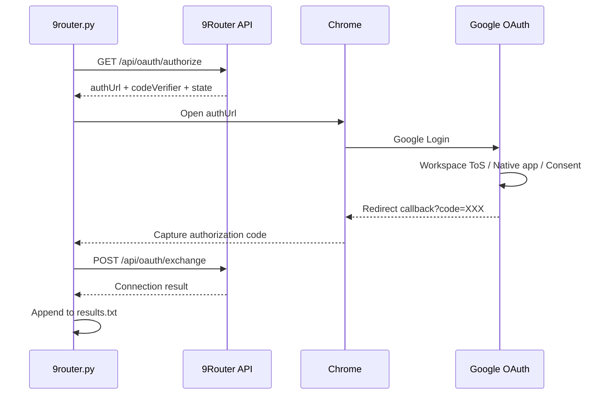

 <div align="center">

<pre>
█████╗ ██████╗  ██████╗ ██╗   ██╗████████╗███████╗██████╗
██╔══██╗██╔══██╗██╔═══██╗██║   ██║╚══██╔══╝██╔════╝██╔══██╗
╚██████║██████╔╝██║   ██║██║   ██║   ██║   █████╗  ██████╔╝
 ╚═══██║██╔══██╗██║   ██║██║   ██║   ██║   ██╔══╝  ██╔══██╗
 █████╔╝██║  ██║╚██████╔╝╚██████╔╝   ██║   ███████╗██║  ██║
 ╚════╝ ╚═╝  ╚═╝ ╚═════╝  ╚═════╝    ╚═╝   ╚══════╝╚═╝  ╚═╝
</pre>

# Mass Google OAuth Automation for 9Router

[](https://python.org)
[](https://playwright.dev)
[](LICENSE)

**Single-file · Zero-config · Multi-worker · Rainbow CLI**

Connect Google Workspace accounts to 9Router with automated OAuth authorization.

</div>

---

## ✨ Features

| | Feature | Description |
|---|---|---|
| 🗂️ | **Single File** | One Python script. No framework, no boilerplate |
| 🌐 | **System Chrome** | Uses your installed Google Chrome — no bundled browser download |
| 🌈 | **Rainbow CLI** | TrueColor ANSI with rainbow banner and colored account frames |
| ⚡ | **Multi-worker** | `WORKERS=N` launches multiple Chrome instances in parallel |
| 🔄 | **Auto-retry** | Retries on `access_denied` with configurable attempts |
| 🛡️ | **OAuth Handling** | Handles account chooser, Workspace ToS, native app page and OAuth consent |
| 💾 | **Instant Save** | Results are written immediately per account — crash-safe |

## 📋 Requirements

- **Python** 3.10+
- **Google Chrome** installed on your system
- **9Router** running

## 🚀 Quick Start

### 1. Clone the repository

```bash
git clone https://github.com/spwmrk/9router-gsuite.git
cd 9router-gsuite
```

### 2. Install dependencies

```bash
pip install -r requirements.txt
```

### 3. Configure accounts

Create an `accounts.txt` file and add your Google Workspace accounts.

```text
user@workspace.com|password
another@workspace.com|password
```

### 4. Run

```bash
python 9router.py
```

## 📝 Account Format

Create `accounts.txt` with one account per line.

```text
user@workspace.com|password123
another@workspace.com:secretpass
third@workspace.com;mypassword
```

Supported delimiters:

`|` `:` `;` `,` `tab` `space`

Lines starting with `#` are ignored.

**Keep your account credentials private. Never commit `accounts.txt` to GitHub.**

## ⚙️ Configuration

All configuration is handled through environment variables.

| Variable | Default | Description |
|---|---|---|
| `ROUTER_URL` | `http://localhost:20128` | 9Router base URL |
| `MAX_RETRY` | `3` | Retry attempts on `access_denied` |
| `HEADLESS` | `0` | Set `1` to enable headless Chrome |
| `WORKERS` | `1` | Number of parallel Chrome instances |

### Linux / macOS

```bash
ROUTER_URL=http://192.168.1.100:20128 WORKERS=3 python 9router.py
```

### Windows PowerShell

```powershell
$env:WORKERS=3
$env:ROUTER_URL="http://192.168.1.100:20128"
python 9router.py
```

## 🖥️ Output

### Console

Each account gets a colored frame with live progress.

```text
┌─ Config ────────────────────────────────────────────┐
│ Target       http://localhost:20128                 │
│ Accounts                                      50    │
│ Retry                                          3    │
│ Workers                                        3    │
│ Status                                     Online   │
└────────────────────────────────────────────────────┘

┌─ 1/50 user@workspace.com ────────────────────────────┐
│ >> Authorize                                        │
│ .. Login                                             │
│ .. Waiting callback                                 │
│ .. Workspace ToS                                    │
│ .. Native app confirmation                          │
│ OK Code captured                                    │
│ >> Exchange                                         │
│ OK user@workspace.com                               │
└────────────────────────────────────────────────────┘

┌─ Results ────────────────────────────────────────────┐
│ OK user@workspace.com                               │
│ OK other@workspace.com                              │
└────────────────────────────────────────────────────┘

50 ok | 0 fail
```

### results.txt

Successful account connections are saved to `results.txt`.

```text
user@workspace.com | 5a93b649-4edc-4b4c-a2c1-f3a996b824a9 | antigravity
other@workspace.com | ce8d2444-18f7-4a2b-9c3d-e5f6a7b8c9d0 | antigravity
```

Format: `email | id | provider`

One line per successful account.

## 🔧 How It Works



### Key Implementation Details

- **Callback race condition** — Captures the authorization code through `page.on("framenavigated")` before a subsequent redirect can overwrite it.
- **Native app page** — Handles the native application confirmation page.
- **Browser reuse** — Uses one Chrome instance per worker with a fresh browser context for each account.
- **Thread-safe output** — Buffers account logs and flushes them atomically to prevent interleaved output in multi-worker mode.

## 📁 Project Structure

```text
9router-gsuite/
├── 9router.py          # Main automation script
├── requirements.txt    # Python dependencies
├── accounts.txt        # Account credentials (local only)
├── results.txt         # Successful account results
├── .gitignore          # Git ignore rules
├── LICENSE             # MIT License
└── README.md
```

## ⚠️ Disclaimer

> **USE AT YOUR OWN RISK.**
>
> This tool automates OAuth connections to 9Router using Google Workspace accounts.
>
> The use of Google accounts or OAuth sessions with third-party proxy or router services may not be officially supported by the relevant providers.
>
> Your Google account may be subject to restrictions or suspension depending on the applicable terms of service.
>
> The authors are not responsible for account suspension, data loss, or service disruptions.
>
> By using this tool, you acknowledge and accept responsibility for your actions.

### Additional Notes

- `accounts.txt` contains credentials and must never be committed to GitHub.
- Designed primarily for Google Workspace accounts.
- Multi-worker mode launches multiple Chrome instances. Adjust `WORKERS` according to available system resources.
- Start with `WORKERS=2-3` and adjust based on performance and account-provider limits.

## 📄 License

This project is licensed under the [MIT License](LICENSE).